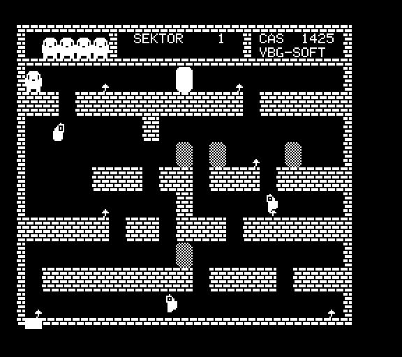
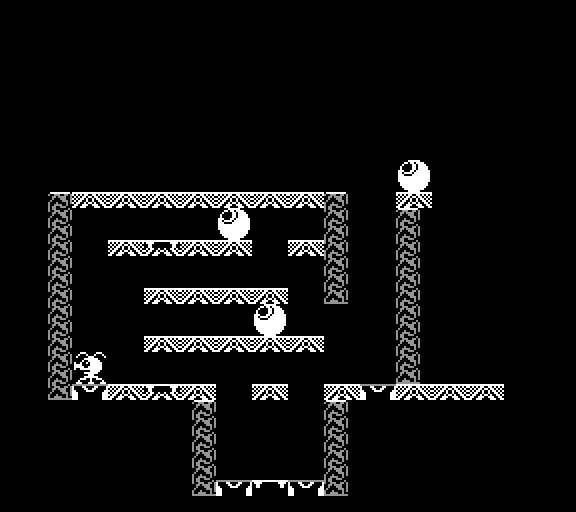
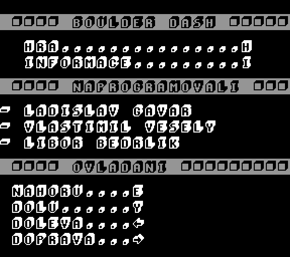

DESCRIPTION

Raspberry Pi 1A+ Tesla PMD-85 retro console powered by modified Petr Tůma <a href="https://github.com/ceresek/simpmd">simpmd</a> (c) 2008.

SCREEN

TODO

- Remove hardcoded paths.
- Menu scroll game preview.
- Fix sound.
- Fix window/renderer duplication.

BUG

- `snd flood alsa lib pcm.c:(snd_pcm_recover) underrun occured`
- `mesa loader: failed to retrieve device information`

HARDWARE

<pre>
1x <a target="_blank" href="http://rpishop.cz/248-raspberry-pi-1a">Raspberry</a> (1A+)
1x <a target="_blank" href="https://www.ges.cz/cz/usb-napajec-napajeci-adapter-mw-5v-1-2a-sun-usb-GES07507424.html">Power adapter</a> (5V 1.2A)
1x <a target="_blank" href="https://www.mironet.cz/edimax-wireless-nano-usb-20-adapter-80211n-150mbps-sw-wps+dp117994/">USB Wifi dongle</a> (RTL8188CUS/50-75mA)
1x <a target="_blank" href="https://www.czc.cz/gembird-cablexpert-kabel-hdmi-hdmi-0-5m-1-4-m-m-stineny-zlacene-kontakty-cerna/248060/produkt">HDMI cable</a> (0.5m)
1x <a target="_blank" href="https://www.alza.cz/roline-usb-2-0-usb-am-micro-usb-bm">Micro USB cable</a> (1m)
1x <a target="_blank" href="https://www.aliexpress.com/item/New-High-Quality-USB-To-TTL-Serial-Module-FTDI-FT232RL-USB-3-3V-5V-To-TTL/32971767031.html">USB FTDI TTL/UART</a> (3.3V 6-pin)
1x MicroSD (2GB)
1x Keyboard (Chicony KU-0108s/100mA)
1x <a target="_blank" href="https://www.ges.cz/cz/l-934gd-GES10700054.html">Green LED</a> (3mm 10mA 2.2V)
1x <a target="_blank" href="https://www.ges.cz/cz/l-934id-GES10701762.html">Red LED</a> (3mm 10mA 2V)
1x <a target="_blank" href="https://www.ges.cz/cz/rm0207-120r-1-GES05300318.html">Resistor 120R</a>
1x <a target="_blank" href="https://www.ges.cz/cz/rm0207-150r-1-GES05300319.html">Resistor 150R</a>
1x <a target="_blank" href="https://www.ges.cz/cz/bls-02-GES06614037.html">BLS 02</a>
2x <a target="_blank" href="https://www.ges.cz/cz/bls-01-GES06614525.html">BLS 01</a>
4x <a target="_blank" href="https://www.ges.cz/cz/bls-contacts-GES06614047.html">BLS contact</a>
1x <a target="_blank" href="https://www.ges.cz/cz/liyv-14-bl-GES06913880.html">Copper Wire</a> (0.14mm 1m)
4x <a target="_blank" href="https://www.ges.cz/cz/esst-m2-2x6-GES06814889.html">Screw</a> (M2.2x6mm)
</pre>

INSTALLATION (Raspberry Pi Imager, Raspberry Pi OS Trixie Lite 32-bit, tested on Pi A+)

<pre>
1. Raspberry Pi Imager: device Raspberry Pi Zero/1 (the A+ is ARMv6), OS "Raspberry Pi OS (other)" ->
   "Raspberry Pi OS Lite (32-bit)", then in the customisation dialog set:
     hostname        pmd85
     user + password pmd85 / <password>
     wireless LAN    SSID, password, country (skip when using Ethernet)
     services        enable SSH (password or public key)
   Write the card, put it into the Pi (monitor connected and switched on), power on, wait for the first boot
   (several minutes on the A+, it resizes the card and applies the settings).

2. From the PC (the Pi needs the network, sudo without password is needed by deploy.sh):
     ssh pmd85@pmd85.local 'echo "pmd85 ALL=(ALL) NOPASSWD:ALL" | sudo tee /etc/sudoers.d/010_pmd85'
     raspberry/deploy.sh pmd85@pmd85.local
   It builds on the Pi (about 10 minutes), installs ROMs, tapes and `games.lst` to ~/share and installs and
   starts pmd85.service, the HDMI wait/hotplug script and the persistent journal (see DEPLOY AND SERVICE).

3. Faster boot (cloud-init, swap resize and network wait take about 2 minutes on the A+):
     scp raspberry/fastboot pmd85@pmd85.local: ; ssh pmd85@pmd85.local 'sudo ./fastboot apply'
   `fastboot revert` restores the originals. Wi-Fi profiles are not recreated, only DHCP Ethernet.

4. Splash screen (random scene on every boot, see PLYMOUTH below), on the Pi:
     sudo apt install plymouth plymouth-themes
     sudo cp -r theme-pmd85 /usr/share/plymouth/themes/        # copy the directory to the Pi first
     sudo plymouth-set-default-theme -R theme-pmd85            # rebuilds the initramfs, takes minutes
   /boot/firmware/cmdline.txt needs `quiet splash plymouth.ignore-serial-consoles` (the Imager image has them).

5. Settings (optional), ~/pmd85.env, `chmod 600`, one VAR=value per line, then `sudo systemctl restart pmd85`:
     PMD_WEB=8085  PMD_WEB_TOKEN=<secret>     remote control from a browser
     SDL_AUDIODRIVER=alsa  AUDIODEV=plughw:0,0   HDMI sound (plughw:1,0 is the headphone jack)

6. Check: `systemctl status pmd85`, `journalctl -b -u pmd85` (log of the emulator, kept over reboots),
   `vcgencmd get_throttled` (0x0 is OK; 0x50005 means a weak power supply, expect crackling and slowdowns).
</pre>

Old manual installation notes (Raspbian Stretch, 2018):

RPI

<pre>
wget --no-check-certificate https://downloads.raspberrypi.org/raspbian_lite_latest
# umount & write SD card / SD reader[!]
umount /dev/sdX[12] 2>/dev/null
unzip -p 2018-11-13-raspbian-stretch-lite.zip | dd of=/dev/sdX bs=4M

touch /boot/ssh
cat << EOF >> /boot/wpa_supplicant.conf
country=CZ
ctrl_interface=DIR=/var/run/wpa_supplicant GROUP=netdev
update_config=1
network={
	ssid="Wireless LAN"
	scan_ssid=1
	psk="cleartext"
	key_mgmt=WPA-PSK
}
EOF

raspi-config > Advanced > GL Driver > Enable Fake KMS

apt-get update
apt-get install libgl1-mesa-dri

raspi-config > Advanced > GPU mem > 128
raspi-config > Advanced > Overclocking > Medium

Overclocking helps: on the Raspberry Pi A+ the emulation and the sound (the speaker samples are generated in real time,
a late emulation thread is a dropout) need the headroom. The Medium preset is 900 MHz (`arm_freq=900`, `over_voltage=2`
in `/boot/firmware/config.txt`); a good power supply is required, undervoltage throttles the clock back.

dphys-swapfile swapoff
dphys-swapfile uninstall

systemctl disable avahi-daemon bluetooth paxctld rsync triggerhappy triggerhappy.socket nfs-client.target \
                  systemd-timesyncd apt-daily apt-daily.timer apt-daily-upgrade apt-daily-upgrade.timer \
                  dphys-swapfile networking dhcpcd ssh getty@tty1 rc-local wifi-country keyboard-setup \
                  alsa-restore systemd-rfkill

raspberry/deploy.sh [-p port] [-i key] [-n] [-o] user@host   (from the PC: sync, build, data, service; see below)

apt-get install vim mc ntpdate

/etc/fstab:
tmpfs	/tmp	tmpfs	defaults,noatime,nosuid,size=5m	0	0
tmpfs	/var/log	tmpfs	defaults,noatime,nosuid,mode=0755,size=5m	0	0

/etc/dhcpcd.conf:
interface wlan0
static ip_address=192.168.0.85/24
static routers=192.168.0.1
static domain_name_servers=xx.xx.xx.xx xx.xx.xx.xx
</pre>

UART

<pre>
3.3V UART => | x | x | GND | TX | RX | ..
             | x | x |  x  | x  | x  | ..

minicom -D /dev/ttyUSB0 -b 115200

[Ctrl] > [A] > [Z] > [O] > Serial port setup > [F]low control > Off
</pre>

LED

<pre name="led">
.. |  x  | x | x | x |  x  | x | x | x | GND | 16 | x | x |
.. | 3v3 | x | x | x | GND | x | x | x |  x  | x  | x | x |

           [RED]                    [GREEN]
            | |                       | |
     150R --  |                120R --  |
     [BGB]     -- 3.3V[17]     [BRB]     -- GPIO16[36]
       |                         |
      GND[25]                   GND[34]

/boot/config.txt:
# PWR LED(disable onboard)
dtparam=pwr_led_trigger=none
dtparam=pwr_led_activelow=off

# ACT LED GPIO16[36]
dtparam=act_led_gpio=16
dtparam=act_led_trigger=cpu
</pre>

PLYMOUTH

<pre>
apt-get install plymouth plymouth-themes -> 0.9.4-1.1(Buster)

cp -r theme-pmd85 /usr/share/plymouth/themes/

plymouth-set-default-theme -R theme-pmd85

The theme picks one of 7 scenes at random on every boot (computer drawing, 4 game logos, monitor, tape loading)
and shows a block progress bar with a blinking cursor. Scenes are generated by `theme-pmd85/make-splash.py`
(Pillow), after adding a scene update `SCENES` in `theme-pmd85.script`; the initramfs must be rebuilt (`-R`).

/usr/share/plymouth/plymouthd.defaults:
DeviceTimout=10

systemctl disable plymouth-start -> Shutdown/reboot only.

/boot/cmdline.txt:
logo.nologo quiet splash plymouth.ignore-serial-consoles vt.global_cursor_default=0

/boot/config.txt:
boot_delay=0
</pre>

SDL2

<pre>
wget --no-check-certificate https://www.libsdl.org/release/SDL2-2.0.9.tar.gz

apt-get install libgles2-mesa-dev libgbm-dev libudev-dev libasound2-dev liblzma-dev

autogen.sh
./configure --enable-video-kmsdrm --disable-video-opengl --disable-video-x11 --disable-video-rpi
make
make install

wget --no-check-certificate https://www.libsdl.org/projects/SDL_ttf/release/SDL2_ttf-2.0.15.tar.gz
autogen.sh
./configure
make
make install
</pre>

SIMPMD

<pre>
make clean
make PMD_BUILD=RELEASE PMD_SHARE=/usr/share/simpmd/
</pre>

`PMD_SHARE` is the directory (with trailing slash) holding ROMs `M1`/`M2-Patched-Tape`, `atari-classic.ttf`, logos `*.bmp`,
`games.lst` and game tapes in one flat directory; `raspberry/deploy.sh` creates it (`~/share`).

RUN

<pre>
bin/simpmd                  # logo -> menu: select game [<-][->], start [Enter] (the load command is typed automatically), quit [hold Esc]

# Start game directly (skip logo and menu), index: 0 FLAPPY, 1 BOULDER, 2 MANIC+, 3 FRED
PMD_AUTOSTART=0 bin/simpmd

# Start and load game automatically, no keyboard needed (examples, tested)
PMD_AUTOSTART=0 PMD_KEYS='MGLD 03|____H__ ____' bin/simpmd                  # FLAPPY: load, [H] play, [Space] skip controls
PMD_AUTOSTART=3 PMD_KEYS='MGLD 03|____H__ ____' bin/simpmd                  # FRED: load, [H] play, [Space] skip info
PMD_AUTOSTART=1 PMD_KEYS='MGLD 03|________H' bin/simpmd                     # BOULDER: load (~20s), [H] game menu
</pre>

Environment variables (test mode):

<pre>
PMD_AUTOSTART=<0-3>     Skip logo and menu, start selected game.
PMD_GAME=<name>         Skip logo and menu, start a game of games.lst (any of the list).
PMD_KEYS=<text>         Type text on the PMD-85 keyboard, '|' is [Enter], '_' is 2s pause, '<' '>' are the cursor
                        keys left and right, '^' is [Shift], E and Y are up and down in the games.
                        '~' waits until the tape stops loading (PMD_TAPE_IDLE_MS without a read).
PMD_TAPE_IDLE_MS=<ms>   Idle time of the tape for '~' (the autoload of JUMP), default 6000.
PMD_AUTOLOAD=0         Do not type the load command of the game automatically (default on).
PMD_WEB=<port>          Remote control from a browser, see below. PMD_WEB_TOKEN=<secret> protects it.
PMD_SCREENSHOT=<file>   Save screen as BMP after PMD_SCREENSHOT_MS and exit.
PMD_SCREENSHOT_MS=<ms>  Screenshot delay, default 3000.
PMD_KEY_MS=<ms>         Key press/release time of PMD_KEYS, default 150.
PMD_ESC_MS=<ms>         Hold time of Esc (back from a game or the list, quit in the main menu), default 800, 0 = at once.
PMD_BEEPSLOW=1          The monitor beep delay of the games (note length, e.g. INVADERS hits) as in the PMD 85-2/2A ROM.
PMD_SNDSTATS=1          Print sound underrun statistics on exit; 2 also logs each underrun/drop with its time to stderr.
PMD_SNDRATE=<Hz>        Sound sampling rate, default 48000.
PMD_SNDBUF=<ms>         Sound hardware buffer, default 50 (rounded up to a power of two of samples).
PMD_SCALE=<n>           Window size multiplier (288x256 * n), default 3; window is resizable.
PMD_ASPECT=<shape>      Picture shape: stretch (default, fills the window), square (square pixels) or 4:3
                        (original PMD-85 monitor); the rest of the window is black.
PMD_REFRESH=<ms>        Screen paint period, default 40; only changed lines are decoded and uploaded.
PMD_RES=<w>x<h>         Video mode of the menu, logo and fullscreen (must be offered by the display).
PMD_KEYLOG=<file>       Log keyboard and window events, paint duration and queue lag.
PMD_PAD=<input>=<key>,...  Gamepad keys, see below.
</pre>

GAMES LIST

The menu shows four games with logos. [Up] or [E] (gamepad up) opens the list of all games from `games.lst`
in the share directory (one `NAME;MODEL;NOTE` line per tape, `NAME` is the tape file, `MODEL` 1 or 2 selects the
PMD 85-1 or PMD 85-2 ROM `M1` or `M2-Patched-Tape`, `NOTE` is shown in the list, the commands to type).
The emulator types them itself after the start of a game: `MGLD 00` and, for `MGLD 00, JUMP 2000`, the `JUMP`
once the tape stops loading, so selecting a game is enough. `PMD_AUTOLOAD=0` turns it off (type the commands by hand).
[Up]/[Down] or [E]/[Y] select, [Left]/[Right] move by a page, [Enter] starts, [Esc] (hold it ~1 s) goes back to the menu.
`simpmd/data/games.lst` lists the tapes of `simpmd/data/tapes` that work, according to the table in `simpmd/README`.
To add a game, copy its tape to the share directory and add a line to `games.lst`.
An optional fourth column `REMAP` changes keys for one game (`Left=Left Shift,Right=V`, SDL key names, also
for the gamepad and the browser): AUTO steers with [Shift] (left) and [V] (right) on the PMD 85, here with the
cursor keys. ZED does the same.
A fifth column `PAD` sets the buttons of the web remote control for a game, `Label:key,...` (SDL key names),
for example `Left:Left,Fast left:End,Fire:Space,0:0`; `key&key` presses two keys at once (a mouse presses only one button), e.g. `Jump left:Left Shift&Left` in MANIC; games without it get the default set (E, Y, cursor keys,
Space, Enter, H, I, Shift, RCL, Esc) and the menus get a short one. The keys known from the code of the games
are listed in `games.lst` (INVADERS: fast arrows, fire and the difficulty digits; AUTO, ZED, MANIC, SASKO, ...). INVADERS moves the ship by 3 steps with the fast arrows [End] and [PageDown] (the keys LLEFT and RRIGHT of the PMD 85), the gamepad [LB] and [RB] send them there. The difficulty (0-3, 4 is not playable) can be chosen with the gamepad: D-pad up = 0, D-pad down = 1, [X] = 2, [Y] = 3. 
A sixth column `KEYS` is a free text with the controls of the game (without diacritics); the games list shows it under
the list for the selected game, "neznamo" is shown for games without it (many games do not print their keys).
Start a game of the list directly (test mode): `PMD_GAME=BLUDISTE bin/simpmd`. `PMD_KEYS` replaces the automatic
load command.

KEYBOARD MAPPING

PC keys are mapped by SDL key code (the meaning of the key, not its position), the table is `oKeyMap` in
`simpmd/src/sim_keyboard.c`. Letters, digits, [Space], [Enter], `,` `.` `/` and `;` are the same keys on the PMD 85.
The rest, with the PMD 85 key name:

| PC | PMD 85 |
|---|---|
| [Y] | Z (the PMD 85 has QWERTZ, so [Z] is on the PC [Y] and the PC [Z] is Y) |
| [F1]-[F12] | K0-K11 |
| [Insert], [Delete], Numpad [+] | WRK, CD, RCL |
| [Home], [Up], [PageUp] | INS, DEL, CLR |
| [Left] or [Backspace], [Right], Numpad [5] | LEFT, RIGHT, HOME |
| [Down] | END |
| [End], [PageDown] | LLEFT, RRIGHT (fast left and right, 3 steps) |
| `-`, `=` | underscore, curly brace |
| `[`, `]` | at sign, backslash |
| `'`, `` ` `` | colon, brace |
| [Shift] (either) | SHIFT |
| [Ctrl] (either) | STOP |

Reference: what to press on the PC to get a character on the PMD 85-2 (US layout, checked in the emulator by typing every
key without and with [Shift]; the key caps are those of a PMD 85-2, see
[a photo of the keyboard](https://cdn.aukro.cz/images/sk1758901075719/pocitac-tesla-pmd-85-2-so-zasuvnym-modulom-basic-g-85-2-neskusane-241607459.jpeg),
a sales listing that may disappear). On the PMD 85 the symbol written top left on a key is the one with [Shift].

| PC key | PMD 85 key | without [Shift] | with [Shift] |
|---|---|---|---|
| `1` ... `9` | `1` ... `9` | `1` ... `9` | `!` `"` `#` `$` `%` `&` `'` `(` `)` |
| `0` | `0` | `0` | **`-`** (the key shows an overline) |
| `-` | `= _` | `_` | `=` |
| `[` | `` ` @ `` | `@` | `` ` `` |
| `]` | `^ \` | `\` | `^` |
| `;` | `+ ;` | `;` | `+` |
| `'` | `* :` | `:` | `*` |
| `` ` `` | `[ ]` | `[` | `]` |
| `,` `.` `/` | `< ,` `> .` `? /` | `,` `.` `/` | `<` `>` `?` |
| `Y` | `Z` | `z` | `Z` |
| `Z` | `Y` | `y` | `Y` |
| other letters, [Space] | same | letters | capitals |
| [Left] or [Backspace], Numpad [5], [Right] | `<-`, `HOME` (arrow up left), `->` | | |
| [Home], [Up], [PageUp] | `PTL INS`, `DEL`, `CLR` | | |
| [End], [Down], [PageDown] | `\|<-`, `END`, `->\|` | | |
| [Insert], [Delete], Numpad [+] | `WRK`, `C-D`, `RCL` | | |
| [F1] ... [F12] | `K0` ... `K11` | | |
| [Enter] | `EOL` | | |
| [Shift] (either) | red up arrow key = Shift | | |
| [Ctrl] (either) | `STOP` | | |

The key `{ }` of the PMD 85 is the PC key with the code `+` (SDL `SDLK_PLUS`), which a US keyboard does not have
([Shift]+[=] is still the `=` key), so it can not be typed there; its characters were not checked. [RST] and the second red
arrow key (right of `/`) are not mapped. The keys are matched by the key code, a keyboard layout that puts the
digits behind [Shift] (Slovak, Czech) changes the table.

What the PMD 85 keys do (only what is documented; the keys are also in the manuals of the PMD 85, not in this repository):

- [STOP] (Ctrl here) interrupts a running tape operation, e.g. recording to tape (not on the PMD 85-1).
- [Shift]+[RCL] switches from BASIC to the monitor (PMD 85-2, 2A, 3). [Shift]+[DEL] starts a program loaded at 0000h
  (PMD 85-1). (GPMD85emu uses [Shift]+[PageUp] and [Shift]+[Delete] for these, here they are [Shift]+Numpad [+] and [Shift]+[Delete].)
- [K0]-[K11] are function keys without a fixed meaning, the program decides (e.g. [F1] is a menu key in MANIC, [RCL] and [F12] are
  buttons of SASKO, DOMCEKY and ROBOTIK).
- [INS], [DEL], [CLR], [HOME], [END] edit the line and the screen as the names say; [LLEFT] and [RRIGHT] move the cursor
  by more than one step (games use them as fast arrows).
- Under CP/M the keys produce control codes: [WRK] = Ctrl-K, [RCL] = Ctrl-W, [END] = Ctrl-C, [Shift]+[CLR] = Ctrl-A,
  [K0]-[K11] = Ctrl-A to Ctrl-L (full table: `Ctrl-CPM-PMD85.txt` of GPMD85emu).
- The meaning of [WRK] and [CD] was not found in the sources available to the author; please add it if you know it.

[Esc] is not a PMD 85 key: the menus use it, in a game held for `PMD_ESC_MS` (800 ms) it returns to the menu.
A key stays pressed for at least 60 ms (`PMD_KBD_HOLD_MS`), otherwise a slow machine could miss a short tap.
`REMAP` in `games.lst` changes the keys for one game, the gamepad and the web remote control send these same keys
(the buttons of the web are set with `PAD`).

NOTES ON GAMES

The commands of KAREL and KAREL3D (the games have no manual): [README.karel.md](README.karel.md).

MESTO (Mesto robotu) asks for a password after the intro screens: `konvalinka` (case does not matter). The game body is
encrypted with a key made of the password (the password is not stored anywhere), so a wrong one starts garbage.

DEPLOY AND SERVICE

`raspberry/deploy.sh [-p port] [-i identity] [-n] [-o] [user@]host` copies `simpmd` and `raspberry` to the Pi, installs
missing build packages, builds (`PMD_SHARE=$HOME/share/`), installs the tapes and `games.lst` to `~/share`
(existing files are kept, `games.lst` is replaced) and installs and starts `pmd85.service` (`-n` skips the service,
`-o` overclocks, takes effect after reboot). The service starts the emulator at boot. Esc in the main menu quits
the emulator and halts the machine, `systemctl stop/restart pmd85` does not. Settings (`PMD_WEB`, `PMD_WEB_TOKEN`,
`PMD_RES`, ...) go to `~/pmd85.env`, one `VAR=value` per line, `chmod 600`. Log: `journalctl -b -u pmd85` (persistent journal, `journald-pmd85.conf`).

The service wakes the TV over HDMI-CEC before the emulator starts (`pmd85-hdmi wake`: the Pi announces itself as a playback
device, sends Image View On and Active Source; needs `cec-ctl` from v4l-utils and a TV with CEC enabled, otherwise it does nothing).

`raspberry/bench.sh GAME [secs] [warmup]` (on the Pi) stops the service, runs one game and prints CPU use per thread, memory
and the throttling state, then starts the service again.

Sound goes straight to ALSA (PipeWire is slow here). The emulator asks for mono 8-bit, which HDMI refuses on `hw:`,
so use the converting `plughw:` device: `SDL_AUDIODRIVER=alsa` and `AUDIODEV=plughw:0,0` for HDMI, `plughw:1,0` for the
headphone jack (`aplay -l` lists the cards). Without them SDL picks the default device.

REMOTE CONTROL

`PMD_WEB=<port>` starts a small web server, open `http://<host>:<port>/?t=<token>` in a browser (PC or phone) to see
the screen of the simulated machine and to play: keyboard keys and an on-screen gamepad are sent to the emulator
and work in the menu and in the games (up and down are [E] and [Y]). `PMD_WEB_TOKEN=<secret>` is required in the
URL (`?t=`), without a token everybody on the network can control the machine. The screen is read from the video
memory (12 KB per frame), there is no sound (it plays on the Pi), traffic is plain HTTP, use it on a trusted network only.
Set it in `~/pmd85.env`: `PMD_WEB=8085` and `PMD_WEB_TOKEN=<secret>`. Esc in the main menu asks for confirmation, it
quits the emulator and halts the Pi, Esc in a game returns to the menu. The first typed key waits until the
simulated processor has run 2 s, so the load command is not lost on a slow Pi.

GAMEPAD

A gamepad (USB, or Bluetooth if paired in the OS) works in the menu and in the games, its buttons are
translated to keyboard keys. Defaults follow the instructions of the games: D-pad and left stick up/down = [E] and [Y] (the PMD 85 keys for
up and down, host key Z), left/right = cursor keys, [A] = Space, [B] and [Start] = Enter, [X] = H, [Y] = I,
[LB] = Shift, [RB] = keypad plus (RCL), [Back] = Escape (game back to menu, in the menu quit).
A game can change this in `games.lst` (`REMAP`): in MANIC [A] jumps (Space is remapped to Shift, so the D-pad and the jump are on different hands).
Override with `PMD_PAD`, inputs `up down left right a b x y lb rb back start`, keys are SDL key names:

<pre>
PMD_PAD='up=Up,down=Down,a=Space,lb=Left' bin/simpmd
</pre>

Bluetooth gamepad (NOT TESTED, only the USB gamepad is): the Pi A+ has no Bluetooth, a USB dongle is needed, `bluez` must be
installed and running (`apt install bluez`, `systemctl enable --now bluetooth`), the gamepad is paired once and trusted
so that it reconnects by itself:

<pre>
bluetoothctl
  power on
  agent on
  scan on
  pair <MAC>
  trust <MAC>
  connect <MAC>
</pre>

The service user needs the `input` group (pmd85.service has it). Not verified: whether a gamepad connected after the emulator
started is picked up, the button mapping of controllers unknown to SDL (check with `evtest`), and the load of the USB
dongle on the weak power supply.

Pads without an SDL controller mapping use a common layout (hat or axes 0/1 = D-pad, buttons 0-7 = a b x y lb rb back start).

Keys after `MGLD 03|` depend on the game, add `_` pauses so the tape load finishes first (BOULDER ~20s, FLAPPY/FRED ~8s).
MANIC+ loads with `MGLD 02` (not 00 or 03), [Enter] starts the game:
`PMD_AUTOSTART=2 PMD_KEYS='MGLD 02|____________|' bin/simpmd`.
BOULDER: the second `H` may be lost, `PMD_KEY_MS=400` makes it pass.

GAMES

Screenshots captured with `PMD_SCREENSHOT` (examples above).

| FLAPPY | FRED | BOULDER DASH (game menu) |
|:------:|:----:|:------------------------:|
|  |  |  |

HEADLESS

No monitor needed, video goes to software renderer and sound to file `sdlaudio.raw`:

<pre>
cd /tmp
PMD_AUTOSTART=0 PMD_KEYS='MGLD 03|____H__ ____' PMD_SCREENSHOT=/tmp/game.bmp PMD_SCREENSHOT_MS=34000 \
SDL_VIDEODRIVER=dummy SDL_RENDER_DRIVER=software SDL_AUDIODRIVER=disk bin/simpmd
</pre>

FILE

<pre>
              openscad/ - 3D printable retro case.
             raspberry/ - Raspbery support scripts.
                simpmd/ - Modified SDL2 PMD-85 emulator source code by Petr Tůma (c) 2008.
           theme-pmd85/ - Splash Plymouth theme.

       pmd85console.png - Retro console final.
pmd85console_schema.png - Retro console schematics.
      atari-classic.ttf - TTF font by Mark Simonson (c) 2016.
</pre>

SOURCE

https://github.com/KyomaHooin/pmd85console

